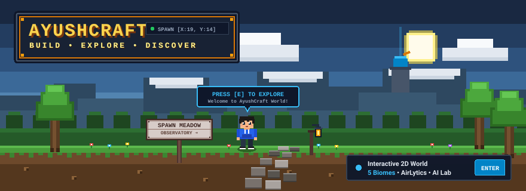
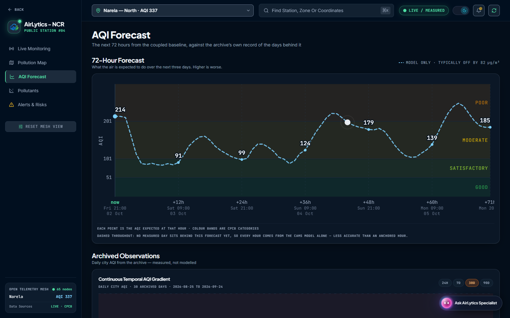

<!-- AYUSHCRAFT WORLD BANNER -->

# ⛏️ AYUSHCRAFT — A Tiny Developer World
### *Build. Explore. Discover.*

  <b>Hey, I'm Ayush.</b> Computer Science & Engineering student from India. 
  I build data-driven applications, environmental intelligence systems, and personal software tools. 
  When away from the terminal, I explore Metroidvanias like <i>Hollow Knight</i> and train calisthenics.

---

## 🗺️ Overworld Biomes & Field Map

Instead of a generic flat portfolio, you can explore my projects, technical stack, and personal lore as an interactive 2D top-down indie game world:

| Biome | Landmark | Highlights | World Coordinates |
| :--- | :--- | :--- | :--- |
| **Spawn Meadow** | Welcoming Signpost & Path | Identity, overview, and navigation paths | `[X:19, Y:14]` |
| **The Observatory** | Brass Dome & Telescope | **AirLytics NCR** — 72h air-quality forecasting mesh | `[X:06, Y:07]` |
| **The Workshop** | Crafting Table & Blueprints | **Personal AI Assistant** — Localized agent automation | `[X:31, Y:07]` |
| **Redstone Lab** | Logic Inverters & Lamp | **Technical Arsenal** — Python, TS, FastAPI, Linux, SQL | `[X:07, Y:22]` |
| **The Save Room** | Bench, Lantern & Map | **Lore & Gaming** — Metroidvanias, Hollow Knight, Anime | `[X:31, Y:22]` |
| **The Nether Gate** | Obsidian Portal Frame | **Exit & Contacts** — GitHub, LinkedIn, Email | `[X:19, Y:03]` |

   
  

> 💡 **Prefer reading over playing?** You don't have to enter the game! All project field notes, telemetry benchmarks, verified skills, and contact links are fully written out below. If you'd like to walk around the interactive world, click the **Play in Browser** button above.

---

## 🔭 The Observatory: Featured Project — AirLytics NCR

**Environmental Intelligence & Air-Quality Forecasting Platform for Delhi-NCR**

  

- **Problem Addressed:** Raw telemetry from Central Pollution Control Board (CPCB) monitoring stations across Delhi-NCR is frequently fragmented, lagging, and lacks predictive foresight for citizen health decisions.
- **Architecture & Pipeline:**
  - Ingests real-time continuous ambient air-quality data across a **68-station regional mesh**.
  - Provides a **72-hour predictive forecasting model** with a verified **61.12 µg/m³ RMSE baseline benchmark** evaluated against 4M+ historical station readings.
  - Features an **API-grounded environmental assistant** equipped with traceable tool calls and station telemetry citations.
- **Stack:** Python, FastAPI, React 19, TypeScript, Tailwind CSS, Recharts, Vercel.
- **Links:**
  - 🌐 [AirLytics Live Web Application](https://airlytics-ncr.vercel.app/)
  - 📦 [AirLytics GitHub Repository](https://github.com/Ayush20-lex/airlytics-ncr)

---

## ⚙️ The Workshop: Personal AI Assistant

**Autonomous Task Orchestration & Context Retrieval (High-Level Overview)**

- **Focus:** A private personal AI system designed to streamline research synthesis, local file context indexing, and multi-step developer workflows.
- **Core Principles:**
  - **Tool-Grounded Execution:** Strict schema validation with human-in-the-loop confirmation gates for critical operations.
  - **Context-Aware Retrieval:** Semantic retrieval over localized documentation without uploading proprietary files to public third-party indexes.
  - **Lightweight Architecture:** Minimal runtime overhead, modular agent capabilities, and robust error recovery.
- *Note: Internal architecture, private repositories, and configuration secrets remain confidential.*

---

## ⚡ The Redstone Lab: Verified Technical Arsenal

Only technologies tested and proven through verified projects and systems:

| Category | Primary Technologies | Practical Context |
| :--- | :--- | :--- |
| **Core Languages** | `Python`, `TypeScript`, `Java`, `Bash`, `SQL` | Backend API development, data pipelines, systems scripting |
| **Web & Frontend** | `React 19`, `JavaScript (ES6+)`, `HTML5 Canvas`, `Tailwind CSS`, `Vite` | Interactive applications, spatial rendering, telemetry dashboards |
| **Backend & APIs** | `FastAPI`, `REST APIs`, `Pydantic`, `Uvicorn` | High-throughput asynchronous endpoints, data validation |
| **Platform & Tooling** | `Linux`, `Git`, `GitHub`, `VS Code`, `Vercel` | Daily driver development environment, CI/CD, Git workflows |
| **Data & Systems** | `Data Analysis`, `Data Pipelines`, `Web Audio API` | Environmental telemetry, time-series benchmarks, retro audio synth |

---

## 🛡️ The Save Room: Off-Duty Lore & Gaming

*A quiet bench illuminated by an amber lantern. Rest here before venturing further.*

- **Metroidvania Enthusiast:** Deep appreciation for nonlinear level design, tight movement mechanics, and environmental storytelling — especially in **Hollow Knight**.
- **Anime & Light Novels:** Sci-fi, psychological mysteries, and intricate world-building narratives.
- **Physical Discipline:** Calisthenics, bodyweight training, and progressive overload fundamentals.
- **Linux & Tinkering:** Customizing shell environments, writing automation scripts, and exploring lightweight developer tools.

---

## 🌌 The Nether Gate: Teleport & Contact Coordinates

Looking to collaborate on environmental data projects, AI tooling, or open-source software? Let's connect:

- 🐙 **GitHub:** [@Ayush20-lex](https://github.com/Ayush20-lex)
- 💼 **LinkedIn:** [Ayush Kumar](https://www.linkedin.com/in/ayush-kumar-942081322/)
- ✉️ **Email:** [ayushkumargbp@gmail.com](mailto:ayushkumargbp@gmail.com)
- 📍 **Location:** India (UTC+05:30)

---

  Crafted with custom pixels, pure HTML5 Canvas, and zero bloat for <b>AYUSHCRAFT</b>. 
  &copy; 2026 Ayush Kumar. Open-source exploration.

