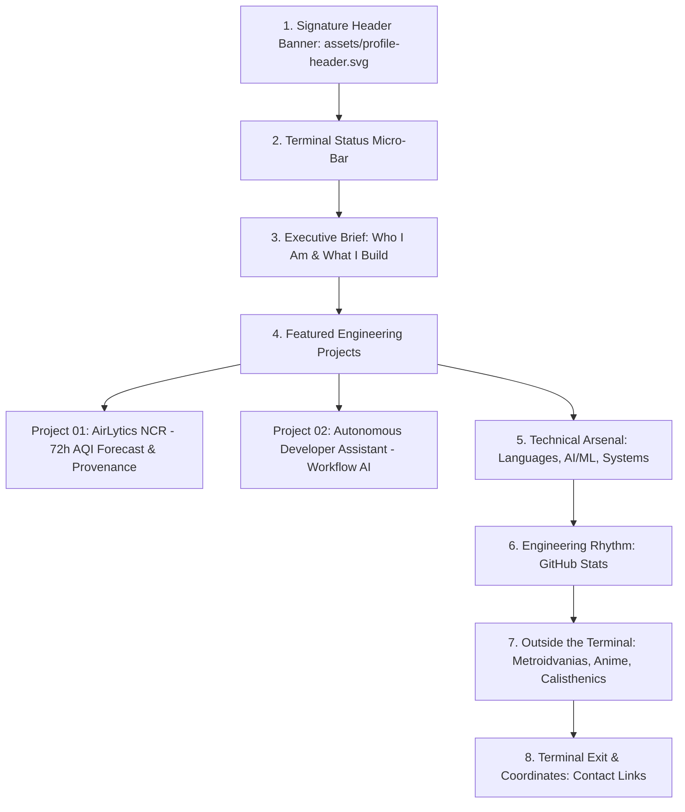

# AYUSH.EXE Profile Redesign — Phase 2 Visual & Architectural Specification

**Target Profile:** [Ayush20-lex](https://github.com/Ayush20-lex)  
**Codename:** `AYUSH.EXE`  
**Tagline:** `Build. Explore. Repeat.` | `Engineering intelligence into reality.`  
**Document:** Visual Design System, Layout Wireframe & Markdown Engineering Specification  
**File Path:** `docs/profile-redesign-spec.md`  

---

## 1. Visual Identity & Creative Direction

The profile embodies an editorial developer identity with a sleek, futuristic terminal aesthetic. It avoids generic AI "SaaS-slop" and cartoonish emoji overload in favor of crisp geometric framing, high-contrast monospace typography, restrained ambient lighting, and subtle nods to retro-modern gaming (Metroidvania precision) and terminal tooling.

### 1.1 Color Palette

| Token | Hex Code | Purpose |
|---|---|---|
| **Void Obsidian** | `#090d16` | Banner canvas and deep background contrast |
| **Dark Charcoal** | `#0d1117` | GitHub native dark canvas compatibility |
| **Card / Surface Border** | `#1e2638` | Subtle geometric dividers and card framing |
| **Electric Cyan** | `#00f0ff` / `#38bdf8` | Primary focal accent: links, headers, prompt cursors |
| **Deep Violet** | `#8b5cf6` / `#a855f7` | Secondary atmospheric accent: gradients, tags, highlights |
| **Terminal Emerald** | `#10b981` | Micro-accent: active status dot, verified badge, build pass |
| **Muted Slate** | `#94a3b8` | Primary technical descriptions and secondary copy |
| **Bright Monospace** | `#e2e8f0` | High-legibility headings and key data points |

---

## 2. Header Artwork Specification (`assets/profile-header.svg`)

### 2.1 Geometry & Dimensions
- **Canvas Size:** 1200 × 300 px
- **Safe Zone:** 1000 × 240 px (centered to prevent clipping on mobile and narrow viewports)
- **Format:** Pure, self-contained SVG with inline `<svg>`, `<defs>`, gradients, patterns, and embedded CSS keyframes.

### 2.2 Visual Elements
1. **Background Grid:** Subtle isometric / Cartesian dot-matrix pattern with radial falloff (opacity 0.08–0.15).
2. **Terminal Status Bar (Top):**
   - Mini status pill: `🟢 AYUSH.EXE // ONLINE`
   - Memory / Region stamp: `NODE_ID: NCR-IND` · `ENV: CSE_STUDENT`
3. **Typographic Focal Point:**
   - Giant stylized header: `AYUSH.EXE` in bold geometric monospace.
   - Dual-tone gradient fill: Gradient from `#38bdf8` (Cyan) to `#8b5cf6` (Violet).
4. **Subhead & Core Line:**
   - `Computer Science & Engineering Student`
   - `AI/ML Systems · Developer Tooling · Environmental Intelligence`
   - Distinctive brand motto: `Build. Explore. Repeat.`
5. **Micro-Details:**
   - Precision brackets `[0x20_LEX]`
   - Clean corner registration markers `+`
   - Ambient glow filter behind the text that remains sharp even if filters are not hardware-accelerated.

---

## 3. Section-by-Section Structural Specification



### 3.1 Section 1: Signature Header
- Centered ``
- Zero bloat, responsive down to 320px mobile.

### 3.2 Section 2: Terminal Status Micro-Bar
- Clean Markdown / inline HTML block simulating an active terminal handshake:
  ```markdown
  > `INITIALIZING AYUSH.EXE` · `STATUS: ACTIVE` · `FOCUS: AI & DISTRIBUTED SYSTEMS`
  ```

### 3.3 Section 3: Identity & Philosophy
- Crisp 3-sentence narrative:
  - Computer Science and Engineering undergraduate based in India.
  - Builder bridging artificial intelligence, statistical forecasting, and terminal-first developer tooling.
  - Focuses on mathematical and provenance-driven software: building systems that explain where every output comes from.

### 3.4 Section 4: Featured Engineering Projects (The Showcase)
Instead of giant clunky tables, use modern high-density Markdown cards with crisp typography, monospace tags, and bulleted technical accomplishments.

#### Card 1: AirLytics NCR — Environmental Intelligence & AQI Forecast
- **Badge/Type:** `🏆 SMART INDIA HACKATHON (SIH26082)` · `PUBLIC REPO` · `LIVE SYSTEM`
- **Headline:** *A 72-hour air quality forecast for Delhi NCR that proves where every number came from.*
- **Key Capabilities:**
  - **Live CPCB Station Mesh:** 68 stations indexed independently under CPCB 2014 arithmetic rules.
  - **Validated ML Blending:** Diurnal persistence blended with bias-corrected CAMS yielding **61.12 µg/m³ RMSE** across 4M+ comparisons.
  - **Zero-Hallucination Assistant:** 8 read-only API tool calls with strict execution provenance.
  - **Stubble Fire Corridor:** Real-time NASA VIIRS satellite clustering aligned with wind vectors.
- **Stack:** Python (FastAPI), React 19, TypeScript, Vite, Open-Meteo, NASA FIRMS, CPCB Data.
- **Action Links:** `[Live Platform ↗](https://airlytics-ncr.vercel.app/)` · `[Source Code ↗](https://github.com/Ayush20-lex/airlytics-ncr)`

#### Card 2: Autonomous Developer Assistant
- **Badge/Type:** `⚡ PERSONAL SYSTEM` · `AI AGENT ARCHITECTURE`
- **Headline:** *Context-aware personal assistant tailored for local terminal environments and developer workflows.*
- **Key Capabilities:**
  - Grounded tool execution for local task orchestration and file management.
  - Intelligent memory systems and multi-modal prompt engineering.
  - Strict security boundary preventing credential leakage.
- **Stack:** Python, AsyncIO, LLM Tooling, Terminal Automation.

### 3.5 Section 5: Technical Arsenal & Tools
Organized into 3 logical, well-structured clusters (no vanity badges, no irrelevant browsers/OS badges):
1. **Languages & Core:** Python, TypeScript, Java, C/C++, Bash / Shell, SQL.
2. **AI, ML & Data Engineering:** PyTorch / TensorFlow, Scikit-Learn, Pandas / NumPy, FastAPI, Data Pipelines.
3. **Environment & Tooling:** Linux / Neovim / Terminal, Git / GitHub, Docker, VS Code, Google Cloud / Vercel.

### 3.6 Section 6: GitHub Activity & Engineering Rhythm
- Custom-themed GitHub stats card configured to match the Cyan/Violet dark theme:
  - Background: `#0d1117`
  - Border: `#1e2638`
  - Title color: `#38bdf8`
  - Text color: `#94a3b8`
  - Accent: `#8b5cf6`
- Graceful degradation: The profile layout remains complete and structurally sound even if the external stats API is unavailable.

### 3.7 Section 7: Outside the Terminal (Personal Lore & Hobbies)
- Formatted as a stylish character loadout / system status:
  - 🎮 **Gaming & Metroidvanias:** Exploring sprawling labyrinthine worlds, precision platforming, and combat mechanics (Hollow Knight, Castlevania, Ori).
  - 📖 **Anime, Light Novels & Manhwa:** Deep worldbuilding, power systems, and strategic narratives.
  - ⚡ **Calisthenics:** Progressive bodyweight training, hand balancing, and physical discipline.

### 3.8 Section 8: Terminal Exit & Coordinates (Contact)
- Sleek, uniform contact pills:
  - **Email:** `ayushkumargbp@gmail.com`
  - **LinkedIn:** `linkedin.com/in/ayush-kumar-942081322`
  - **GitHub:** `github.com/Ayush20-lex`
- Closing terminal sign-off:
  ```markdown
  ```bash
  $ ayush --exit
  Process completed. Build. Explore. Repeat.
  ```
  ```

---

## 4. Markdown Wireframe

```
+-------------------------------------------------------------------------+
|                  [ assets/profile-header.svg (1200x300) ]               |
|            AYUSH.EXE // Build. Explore. Repeat. // ONLINE               |
+-------------------------------------------------------------------------+

> SYSTEM_STATUS: CSE Undergraduate · AI & Environmental Intelligence · India

### 01 // IDENTITY & PHILOSOPHY
[ Concise paragraph on engineering focus, real-world data provenance & systems ]

### 02 // FEATURED SYSTEMS
┌─────────────────────────────────────────────────────────────────────────┐
│ AirLytics NCR — 72-Hour Environmental Intelligence & Provenance Engine │
│ [Live Demo ↗] [Repository ↗]                                            │
│ • Validated 61.12 µg/m³ RMSE blend baseline                             │
│ • 68-station CPCB mesh adhering to strict 2014 arithmetic criteria      │
│ • NASA VIIRS fire corridor & grounded zero-hallucination assistant      │
└─────────────────────────────────────────────────────────────────────────┘
┌─────────────────────────────────────────────────────────────────────────┐
│ Autonomous Developer Assistant — Personal Workflow Agent                │
│ • High-level overview of terminal-first contextual task orchestration   │
└─────────────────────────────────────────────────────────────────────────┘

### 03 // TECHNICAL ARSENAL
[ Languages ]       Python · TypeScript · C/C++ · Java · Bash · SQL
[ AI & Data ]       FastAPI · PyTorch · Scikit-Learn · Pandas · NumPy
[ Systems & Tools ] Linux · Git · Docker · VS Code · Vercel · Cloud

### 04 // ENGINEERING RHYTHM
[ Unified Dark Theme GitHub Stats Card ]

### 05 // OUTSIDE THE TERMINAL
[ Metroidvanias & Gaming ] · [ Anime & Light Novels ] · [ Calisthenics ]

### 06 // TERMINAL EXIT & COORDINATES
[ Email ]  [ LinkedIn ]  [ GitHub ]
$ ayush --exit
```

---

## 5. Engineering Constraints & Quality Assurance Checkpoints

1. **GitHub Native Render Verification:** Every image link is verified against existing paths or robust external URLs.
2. **Zero External CSS/JS:** Strictly valid GitHub Flavored Markdown (GFM) and inline SVG vector assets.
3. **No Stale Badges / Typo Errors:** Eliminates all `hight=` typos and misaligned dimensions from the legacy profile.
4. **Mobile Responsiveness:** All tables or flex blocks collapse cleanly on screens down to 360px wide.
